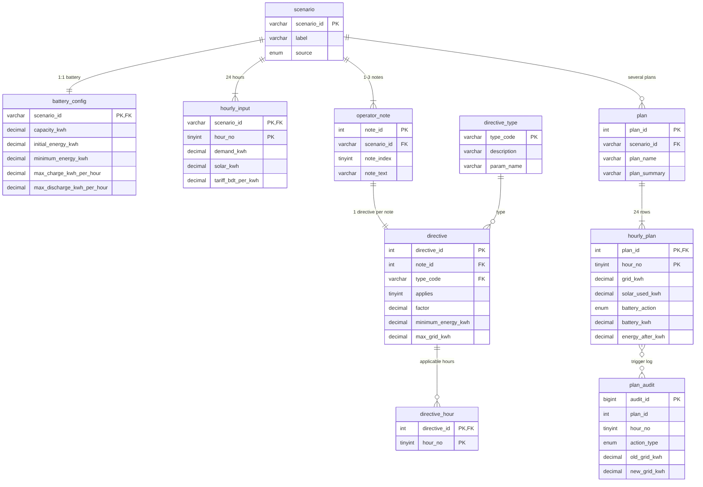
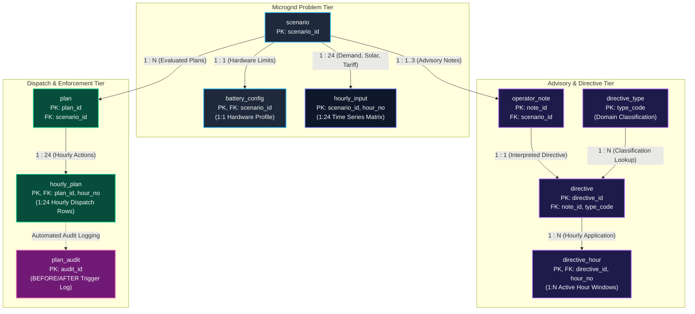
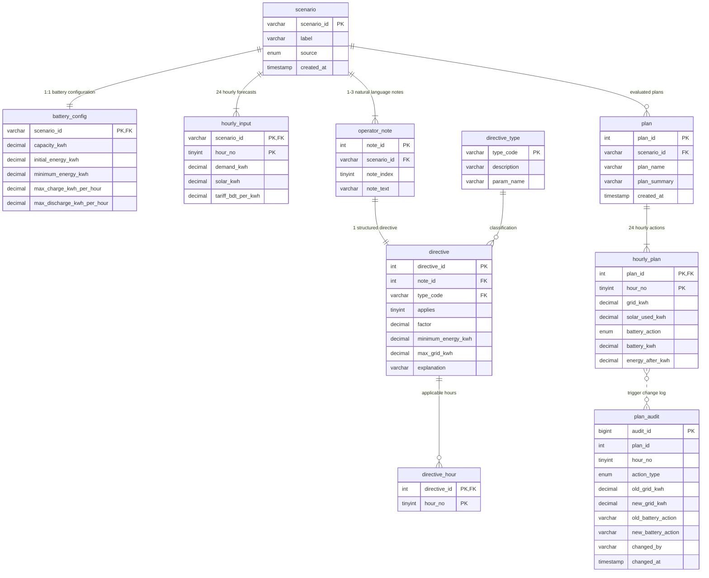

# GridWise: Relational Database Architecture and Enforcement Engine for Microgrid Energy Scheduling

A Comprehensive Technical Manual and Academic Specification for the University Database Systems Course.

**Author**: Md Showkotul Islam  
**GitHub Repository**: [https://github.com/SaKin32/Gridwise_db](https://github.com/SaKin32/Gridwise_db)  
**GitHub Profile**: [https://github.com/SaKin32](https://github.com/SaKin32)  
**Domain Context**: Smart Campus Energy Management (adapted from BUP CSE Fest 2026 Hackathon Problem Specification).  
**Target Platform**: XAMPP Local Environment (MariaDB 10.4+ / MySQL 8.0+) with PHP 7.4+ / 8.x and Modern Web Browsers.  

---

## Table of Contents

1. System Overview and Theoretical Motivation
2. Microgrid Operational Domain and Physical Constraints
3. Relational Schema Architecture and Entity Design
   - 3.1 Entity Decomposition and Data Dictionary
   - 3.2 Formal Normalization Analysis (1NF to BCNF)
   - 3.3 Relational Entity-Relationship (ER) Topology
4. In-Database Integrity and Business Rule Enforcement
   - 4.1 Declarative Schema Constraints (PK, FK, CHECK, UNIQUE)
   - 4.2 Comprehensive Catalog of Stored Database Views
   - 4.3 Procedural Triggers and Automated Audit Trails
   - 4.4 Stored Procedures and User-Defined Functions
5. Complete XAMPP Installation and Deployment Manual
   - 5.1 System Prerequisites and Stack Requirements
   - 5.2 Step-by-Step Installation Walkthrough
   - 5.3 Web Dashboard and RESTful API Integration
   - 5.4 Temporary Online Live Preview (Cloud Tunneling Guide)
6. System Verification, Testing Suite, and ACID Demonstration
   - 6.1 Automated Database Self-Test Harness (sp_selftest)
   - 6.2 Negative Constraint Testing and Exception Interception
   - 6.3 Transactional Atomicity, Savepoints, and Rollback Verification
   - 6.4 Universal Plan Compliance Audit
7. Analytical Query Catalog and Performance Tuning (Q01 to Q26)
   - 7.1 Scenario Metrics and Entity Joins (Q01 to Q05)
   - 7.2 Directive Analytics and Solar Curtailment (Q06 to Q10)
   - 7.3 Energy Balance and Hourly Dispatch Validation (Q11 to Q15)
   - 7.4 Window Functions, Ranking, and Running Aggregations (Q16 to Q20)
   - 7.5 Set Operations, Anti-Joins, and Integrity Checks (Q21 to Q24)
   - 7.6 Index Optimization and Execution Plan Analysis with EXPLAIN (Q25 to Q26)
8. Web Interface and RESTful API Documentation
9. Benchmark Datasets and Synthesis Architecture
10. Theoretical Edge Cases and Engineering Assumptions
11. Complete Directory Tree Structure
12. Viva Examination Guide and Academic Defense Questions
13. Author Information and Project Credits

---

## 1. System Overview and Theoretical Motivation

Traditional undergraduate database coursework frequently presents trivial CRUD (Create, Read, Update, Delete) applications such as student records, library catalogs, or inventory trackers. In such architectures, the database is relegated to a passive storage repository, while all domain validation and constraint enforcement remain embedded in external application code. This architecture introduces grave risks of data corruption whenever multiple services, batch scripts, or direct SQL interfaces bypass the application layer.

The GridWise Database System establishes an enterprise-grade architectural paradigm: moving critical mathematical and operational domain constraints directly into the Relational Database Management System (RDBMS). Utilizing MySQL/MariaDB in a local XAMPP environment, this project implements a smart campus microgrid dispatch system. The database stores 24-hour schedules, tariffs, solar generation forecasts, battery capacities, and operator notes, and it guarantees that no mathematically or physically invalid energy plan can ever be committed to disk.

Key architectural achievements include:
- 10 normalized tables adhering to Boyce-Codd Normal Form (BCNF).
- Declarative integrity constraints restricting domain ranges, rates, and battery levels.
- 6 active triggers employing BEFORE INSERT and BEFORE UPDATE hooks that execute real-time energy balance verification and raise custom SQLSTATE 45000 exceptions upon violations.
- 11 materializing views providing real-time calculations of effective solar, hourly constraints, financial savings, and violation reporting.
- 7 stored procedures and 1 deterministic stored function encapsulating complex operations.
- 18 automated unit tests built natively into a stored procedure (sp_selftest) to test both positive assertions and negative violation rejections.
- 26 complex analytical SQL queries demonstrating multi-table joins, subqueries, Common Table Expressions (CTEs), and SQL window functions.

---

## 2. Microgrid Operational Domain and Physical Constraints

The system models an educational institution operating an integrated electrical network comprising:
1. Public Utility Grid: Supplies electricity subject to hourly variable tariffs (BDT per kWh).
2. Rooftop Solar Photovoltaic (PV) Generation: Produces solar power (kWh) during daylight hours, subject to weather conditions and maintenance curtailment. Unused solar cannot be fed back into the external grid in this specification; it is curtailed if unconsumed.
3. Battery Energy Storage System (BESS): A centralized chemical storage unit capable of charging from the grid/solar or discharging to offset campus demand.

### Fundamental Mathematical Rules Governed by the Database

1. Hourly Energy Balance Equation:
   For every hour h from 0 through 23:
   grid_kwh[h] + solar_used_kwh[h] + battery_discharge_kwh[h] = demand_kwh[h] + battery_charge_kwh[h]

2. Solar Usage Constraint:
   solar_used_kwh[h] must be greater than or equal to 0 and less than or equal to effective_solar_kwh[h].
   Effective solar is computed from base solar multiplied by any applicable solar_reduction factor.

3. Battery State Transition Continuity:
   For hour h = 0:
   energy_after_kwh[0] = initial_energy_kwh + battery_charge_kwh[0] - battery_discharge_kwh[0]
   For hour h from 1 to 23:
   energy_after_kwh[h] = energy_after_kwh[h - 1] + battery_charge_kwh[h] - battery_discharge_kwh[h]

4. Battery Boundary Limits:
   For every hour h:
   min_energy_kwh[h] <= energy_after_kwh[h] <= capacity_kwh

5. Charge and Discharge Rate Bounds:
   When battery_action is charge: battery_kwh[h] <= max_charge_kwh_per_hour
   When battery_action is discharge: battery_kwh[h] <= max_discharge_kwh_per_hour
   When battery_action is idle: battery_kwh[h] = 0

6. End-of-Day Battery Neutrality:
   energy_after_kwh[23] = initial_energy_kwh
   This prevents the optimizer or operator from depleting the battery as a one-time free energy source.

7. Operator Directives:
   External textual advisories that dynamically restrict the microgrid:
   - solar_reduction: Reduces available solar by a fractional factor over specific hours.
   - minimum_battery_reserve: Raises the minimum required battery energy during specific hours.
   - no_charge_window: Forces charge energy to exactly 0 during specific hours.
   - no_discharge_window: Forces discharge energy to exactly 0 during specific hours.
   - max_grid_window: Imposes a ceiling on grid import during specific hours.
   - no_op: Unrelated notes that do not alter physical constraints.

---

## 3. Relational Schema Architecture and Entity Design

### 3.1 Entity Decomposition and Data Dictionary

The schema `gridwise_db` decomposes the hierarchical JSON structure into 10 distinct relational tables.

#### Table 1: `scenario`
Represents an individual 24-hour campus energy problem instance.
- `scenario_id` (VARCHAR(30), PK): Unique identifier (e.g., 'SAMPLE-01', 'GRID-101').
- `label` (VARCHAR(120), NOT NULL): Human-readable scenario title.
- `source` (ENUM('public_sample', 'synthetic', 'user'), DEFAULT 'user'): Origin of the data instance.
- `created_at` (TIMESTAMP, DEFAULT CURRENT_TIMESTAMP): Creation timestamp.

#### Table 2: `battery_config`
Contains physical battery hardware parameters (1-to-1 relationship with `scenario`).
- `scenario_id` (VARCHAR(30), PK, FK): References `scenario(scenario_id)` with `ON DELETE CASCADE`.
- `capacity_kwh` (DECIMAL(10,2), NOT NULL): Maximum storage volume in kWh.
- `initial_energy_kwh` (DECIMAL(10,2), NOT NULL): Battery state of charge at hour 0 start.
- `minimum_energy_kwh` (DECIMAL(10,2), NOT NULL): Default lower reserve threshold.
- `max_charge_kwh_per_hour` (DECIMAL(10,2), NOT NULL): Maximum charge rate.
- `max_discharge_kwh_per_hour` (DECIMAL(10,2), NOT NULL): Maximum discharge rate.

#### Table 3: `hourly_input`
Stores the exogenous time-series input parameters for each hour of a scenario.
- `scenario_id` (VARCHAR(30), PK, FK): References `scenario(scenario_id)` with `ON DELETE CASCADE`.
- `hour_no` (TINYINT UNSIGNED, PK): Hour interval [0 to 23].
- `demand_kwh` (DECIMAL(10,2), NOT NULL): Campus electrical demand.
- `solar_kwh` (DECIMAL(10,2), NOT NULL): Forecasted raw solar generation.
- `tariff_bdt_per_kwh` (DECIMAL(10,2), NOT NULL): Cost per kWh from the grid in Bangladeshi Taka.

#### Table 4: `operator_note`
Captures raw natural language advisories received from campus facility operators.
- `note_id` (INT UNSIGNED, PK, AUTO_INCREMENT): Surrogate note key.
- `scenario_id` (VARCHAR(30), FK): References `scenario(scenario_id)` with `ON DELETE CASCADE`.
- `note_index` (TINYINT UNSIGNED, NOT NULL): Zero-based sequence index within the scenario.
- `note_text` (VARCHAR(500), NOT NULL): Raw natural language string.
- UNIQUE KEY: `(scenario_id, note_index)` guarantees single ordering per note.

#### Table 5: `directive_type`
Lookup catalog defining supported operational directive classifications.
- `type_code` (VARCHAR(30), PK): Unique code ('solar_reduction', 'minimum_battery_reserve', etc.).
- `description` (VARCHAR(200), NOT NULL): Human-readable definition.
- `param_name` (VARCHAR(30), NULL): Associated numeric parameter name ('factor', 'minimum_energy_kwh', etc.).

#### Table 6: `directive`
Stores the structured machine interpretation of an operator note (1-to-1 relationship with `operator_note`).
- `directive_id` (INT UNSIGNED, PK, AUTO_INCREMENT): Surrogate directive key.
- `note_id` (INT UNSIGNED, FK, UNIQUE): References `operator_note(note_id)` with `ON DELETE CASCADE`.
- `type_code` (VARCHAR(30), FK): References `directive_type(type_code)`.
- `applies` (TINYINT(1), NOT NULL): Boolean flag (1 for active directives, 0 for no_op).
- `factor` (DECIMAL(5,4), NULL): Usable solar multiplier [0.0000 to 1.0000].
- `minimum_energy_kwh` (DECIMAL(10,2), NULL): Overriding battery reserve limit.
- `max_grid_kwh` (DECIMAL(10,2), NULL): Overriding hourly grid import cap.
- `explanation` (VARCHAR(500), NOT NULL): Semantic rationale of the directive.

#### Table 7: `directive_hour`
Associates active directives with specific target hours (normalized many-to-many relationship).
- `directive_id` (INT UNSIGNED, PK, FK): References `directive(directive_id)` with `ON DELETE CASCADE`.
- `hour_no` (TINYINT UNSIGNED, PK): Target hour integer [0 to 23].

#### Table 8: `plan`
Header table for evaluated 24-hour microgrid dispatch schedules.
- `plan_id` (INT UNSIGNED, PK, AUTO_INCREMENT): Surrogate plan identifier.
- `scenario_id` (VARCHAR(30), FK): References `scenario(scenario_id)` with `ON DELETE CASCADE`.
- `plan_name` (VARCHAR(60), NOT NULL): Name of the operating plan (e.g., 'optimal', 'baseline_heuristic').
- `plan_summary` (TEXT, NULL): Textual summary of the dispatch strategy.
- `created_at` (TIMESTAMP, DEFAULT CURRENT_TIMESTAMP): Plan creation timestamp.
- UNIQUE KEY: `(scenario_id, plan_name)`.

#### Table 9: `hourly_plan`
Stores the 24 hourly dispatch rows per plan.
- `plan_id` (INT UNSIGNED, PK, FK): References `plan(plan_id)` with `ON DELETE CASCADE`.
- `hour_no` (TINYINT UNSIGNED, PK): Hour interval [0 to 23].
- `grid_kwh` (DECIMAL(10,2), NOT NULL): Electricity imported from the public utility.
- `solar_used_kwh` (DECIMAL(10,2), NOT NULL): Solar power utilized directly or directed to the battery.
- `battery_action` (ENUM('charge', 'discharge', 'idle'), NOT NULL): Operational state of the battery.
- `battery_kwh` (DECIMAL(10,2), NOT NULL): Absolute magnitude of energy charged or discharged.
- `energy_after_kwh` (DECIMAL(10,2), NOT NULL): Battery state of charge at the end of the hour.

#### Table 10: `plan_audit`
Append-only historical audit log populated automatically via database triggers.
- `audit_id` (BIGINT UNSIGNED, PK, AUTO_INCREMENT): Chronological audit sequence number.
- `plan_id` (INT UNSIGNED, NOT NULL): Affected plan identifier.
- `hour_no` (TINYINT UNSIGNED, NOT NULL): Affected hour index.
- `action_type` (ENUM('INSERT', 'UPDATE', 'DELETE'), NOT NULL): Triggered operation.
- `old_grid_kwh`, `new_grid_kwh` (DECIMAL(10,2)): Pre- and post-operation grid imports.
- `old_battery_action`, `new_battery_action` (VARCHAR(10)): State transition logging.
- `changed_by` (VARCHAR(60), NOT NULL): Database user responsible for mutation.
- `changed_at` (TIMESTAMP, DEFAULT CURRENT_TIMESTAMP): Exact audit timestamp.

---

### 3.2 Formal Normalization Analysis (1NF to BCNF)

The schema was designed to satisfy Boyce-Codd Normal Form (BCNF) across all relations:

1. First Normal Form (1NF):
   - Every column contains exclusively atomic (indivisible) values.
   - Repeating groups such as 24-hour inputs and applicable directive hours are isolated into separate relations (`hourly_input`, `directive_hour`, `hourly_plan`) rather than stored as comma-delimited strings or JSON arrays.
   - Primary keys are explicitly defined for every table.

2. Second Normal Form (2NF):
   - The relations are in 1NF.
   - Every non-prime attribute is fully functionally dependent on the entire primary key. In tables with composite primary keys (`hourly_input`, `directive_hour`, `hourly_plan`), no non-key attribute depends on a proper subset of the key.
   - Example: In `hourly_input(scenario_id, hour_no)`, attributes `demand_kwh`, `solar_kwh`, and `tariff_bdt_per_kwh` depend on both the specific scenario and the specific hour, not on `scenario_id` alone.

3. Third Normal Form (3NF):
   - The relations are in 2NF.
   - No transitive functional dependencies exist (no non-prime attribute depends on another non-prime attribute).
   - Non-stored derived attributes: Calculated metrics such as `total_cost_bdt`, `total_grid_kwh`, and `peak_grid_kwh` are deliberately excluded from physical tables and computed dynamically via stored views (`v_plan_totals`), eliminating update anomalies.
   - Hardware battery parameters are decoupled from `scenario` into `battery_config` to ensure scenario records remain purely administrative.

4. Boyce-Codd Normal Form (BCNF):
   - For every functional dependency X -> Y, X is a superkey.
   - In `directive(directive_id, note_id, type_code, applies, ...)`, `note_id` is unique and `directive_id` is unique; every determinant is a candidate key.

---

### 3.3 Relational Entity-Relationship (ER) Topology

The database topology decouples operational inputs, semantic operator directives, and executable dispatch schedules into modular relational tiers.

#### Visual Architecture Diagram



#### Functional Microgrid Relational Topology (Mermaid)



#### Detailed Entity-Relationship Diagram (Crow's Foot Notation)



---

## 4. In-Database Integrity and Business Rule Enforcement

### 4.1 Declarative Schema Constraints

Declarative integrity is enforced at the Data Definition Language (DDL) layer in `sql/01_schema.sql`:

- Battery Hardware Bounds:
  ```sql
  CONSTRAINT ck_battery_capacity CHECK (capacity_kwh > 0),
  CONSTRAINT ck_battery_levels CHECK (
    minimum_energy_kwh >= 0 AND
    minimum_energy_kwh <= initial_energy_kwh AND
    initial_energy_kwh <= capacity_kwh
  ),
  CONSTRAINT ck_battery_rates CHECK (
    max_charge_kwh_per_hour > 0 AND
    max_discharge_kwh_per_hour > 0
  )
  ```
- Hourly Boundaries:
  ```sql
  CONSTRAINT ck_hourly_hour CHECK (hour_no BETWEEN 0 AND 23),
  CONSTRAINT ck_hourly_values CHECK (
    demand_kwh >= 0 AND
    solar_kwh >= 0 AND
    tariff_bdt_per_kwh >= 0
  )
  ```
- Directive Parameter Consistency:
  ```sql
  CONSTRAINT ck_directive_applies CHECK (
    (applies = 0 AND type_code = 'no_op' AND factor IS NULL AND minimum_energy_kwh IS NULL AND max_grid_kwh IS NULL) OR
    (applies = 1 AND type_code <> 'no_op')
  ),
  CONSTRAINT ck_directive_factor CHECK (factor IS NULL OR (factor >= 0 AND factor <= 1))
  ```

---

### 4.2 Comprehensive Catalog of Stored Database Views

Stored views (`sql/02_views.sql`) encapsulate cross-table aggregations and calculations, ensuring uniform application logic across queries, procedures, and web endpoints:

1. `v_directive_hours`: Denormalizes active directives with their target hours and parent scenario metadata.
2. `v_hour_constraints`: Reconciles base hourly inputs with all active directives for each (scenario, hour). If multiple directives target the same hour, the view resolves conflicts deterministically (e.g., minimum factor for solar reduction, maximum reserve for battery, minimum cap for grid import).
3. `v_plan_rows`: Joins `hourly_plan` with `v_hour_constraints` and uses a self-join (`LEFT JOIN ... ON prev.hour_no + 1 = hp.hour_no`) to expose preceding battery states and calculate hourly financial expenditures.
4. `v_plan_totals`: Dynamically computes `total_grid_kwh`, `total_cost_bdt`, and `peak_grid_kwh` per plan, preserving 3NF by avoiding redundant stored totals.
5. `v_plan_violations`: A diagnostic view returning row-level violations across 11 discrete failure modes (e.g., `SOLAR_EXCEEDS_AVAILABLE`, `ENERGY_BALANCE`, `BATTERY_TRANSITION_WRONG`, `END_OF_DAY_NEUTRALITY`, `GRID_CAP_EXCEEDED`). An empty result indicates complete plan validity.
6. `v_plan_status`: Classifies each plan as 'VALID' or 'INVALID' alongside total monetary cost.
7. `v_directive_summary`: Provides a human-readable synthesis of directives, concatenating affected hours into comma-delimited strings (`GROUP_CONCAT(dh.hour_no ORDER BY dh.hour_no)`).
8. `v_directive_issues`: Identifies orphan directives or invalid directive configurations.
9. `v_scenario_overview`: Aggregates top-level operational metrics (total demand, solar yield, active directives, plan counts) per scenario.
10. `v_no_battery_cost`: Computes the financial expenditure of a counterfactual baseline where no battery storage exists (all net demand satisfied solely by grid import).
11. `v_plan_comparison`: Computes absolute monetary savings (BDT) and percentage reduction of a plan compared against `v_no_battery_cost`.

---

### 4.3 Procedural Triggers and Automated Audit Trails

Procedural integrity is guaranteed through 6 active triggers (`sql/03_routines_triggers.sql`):

- `trg_hplan_bi` (BEFORE INSERT on `hourly_plan`): Calls `sp_check_plan_row(...)` prior to inserting any row.
- `trg_hplan_bu` (BEFORE UPDATE on `hourly_plan`): Calls `sp_check_plan_row(...)` prior to modifying any existing row.
- `trg_hplan_au` (AFTER UPDATE on `hourly_plan`): Writes state changes to `plan_audit`.
- `trg_hplan_ad` (AFTER DELETE on `hourly_plan`): Logs record deletions to `plan_audit`.
- `trg_directive_bi` (BEFORE INSERT on `directive`): Validates parameter rules.
- `trg_directive_bu` (BEFORE UPDATE on `directive`): Enforces structural rules on directive updates.

#### Mechanism of Row Rejection via SQLSTATE 45000:
Inside `sp_check_plan_row`, when any mathematical constraint is broken, MySQL triggers an exception:
```sql
IF ABS((p_grid + p_solar + v_discharge) - (v_demand + v_charge)) > 0.01 THEN
  SIGNAL SQLSTATE '45000'
    SET MESSAGE_TEXT = 'Rule violation: hourly energy balance broken (grid + solar + discharge != demand + charge)';
END IF;
```
Because this occurs in a `BEFORE` trigger, the offending statement fails immediately and any surrounding transaction is halted.

---

### 4.4 Stored Procedures and User-Defined Functions

- `fn_plan_cost(p_plan_id INT UNSIGNED) RETURNS DECIMAL(14,2)`: Deterministic scalar function returning the total calculated grid electricity cost of a given plan.
- `sp_check_plan_row(...)`: Core validator evaluating 10 physical conditions for a single hourly dispatch row.
- `sp_validate_plan(p_plan_id INT UNSIGNED)`: Evaluates a 24-hour plan against `v_plan_violations` and returns either 'VALID' or the enumerated list of failure codes.
- `sp_plan_report(p_plan_id INT UNSIGNED)`: Produces an audit report displaying plan metadata, totals, savings relative to baseline, and an hourly dispatch matrix.
- `sp_add_directive(...)`: Atomically inserts an operator note, its directive record, and target hours within a single database transaction.
- `sp_create_baseline_plan(...)`: Generates a zero-battery dispatch schedule for benchmarking.
- `sp_selftest()`: Complete automated test harness executing 18 positive and negative assertions.

---

## 5. Complete XAMPP Installation and Deployment Manual

### 5.1 System Prerequisites and Stack Requirements

- Apache Web Server (Included in XAMPP 8.0+).
- MariaDB 10.4+ or MySQL 8.0+ (Included in XAMPP).
- PHP 7.4+ or 8.x with `pdo_mysql` extension enabled.
- Web Browser: Google Chrome, Mozilla Firefox, Microsoft Edge, or Safari.

---

### 5.2 Step-by-Step Installation Walkthrough

#### Step 1: Initialize XAMPP Services
1. Launch the XAMPP Control Panel with administrative privileges.
2. Click **Start** adjacent to **Apache**.
3. Click **Start** adjacent to **MySQL**.
4. Confirm that both service module labels turn green and display their respective port allocations (Port 80/443 for Apache, Port 3306 for MySQL).

#### Step 2: Deploy the Web Application Directory
1. Locate the `web/` directory within this project repository (`E:\Gridwise_db\web\`).
2. Copy the entire contents of this directory into your local XAMPP web root:
   Target location: `C:\xampp\htdocs\gridwise\`
3. Verify that the file layout in your destination folder matches:
   ```
   C:\xampp\htdocs\gridwise\index.html
   C:\xampp\htdocs\gridwise\api\db.php
   C:\xampp\htdocs\gridwise\api\index.php
   ```

#### Step 3: Configure Database Authentication Credentials
By default, XAMPP ships with user `root` and an empty password. If your local configuration differs:
1. Open `C:\xampp\htdocs\gridwise\api\db.php` in a text editor.
2. Verify or update lines 9-14:
   ```php
   $host = '127.0.0.1';
   $port = '3306';
   $db   = 'gridwise_db';
   $user = 'root';
   $pass = ''; // Enter your password if one is set
   ```

#### Step 4: Import Database Schema and Data

##### Method A: Via phpMyAdmin Web GUI
1. Navigate to `http://localhost/phpmyadmin/` in your browser.
2. Click on the **Import** tab on the top navigation bar.
3. Under **File to import**, click **Choose File** and navigate to:
   `E:\Gridwise_db\sql\install_all.sql`
4. Ensure the format dropdown is set to **SQL**.
5. Scroll to the bottom and click **Import** (or **Go**).
6. Verify that the navigation sidebar lists `gridwise_db` with 10 tables and 11 views.

Note on PHP File Upload Limits: If your `install_all.sql` import is rejected due to file size restrictions in phpMyAdmin, import the modular scripts sequentially:
1. `sql/01_schema.sql`
2. `sql/02_views.sql`
3. `sql/03_routines_triggers.sql`
4. `sql/04_seed_samples.sql`
5. `sql/05_seed_synthetic.sql`

##### Method B: Via Command Line (Windows PowerShell / Command Prompt)
```powershell
cd E:\Gridwise_db\sql
C:\xampp\mysql\bin\mysql.exe -u root -p < install_all.sql
```

---

### 5.3 Web Dashboard and RESTful API Integration

Once deployed:
1. Open your web browser and navigate to:
   `http://localhost/gridwise/index.html`
2. A green badge in the upper right corner displaying **API ok** confirms successful connectivity between the HTML interface, PHP PDO layer, and MySQL database.
3. Explore the dashboard tabs:
   - **Scenario Overview**: Top-level summary of all 70 loaded cases.
   - **Plan Inspector**: Interactive hourly dispatch charts (Grid, Solar, Battery Charge/Discharge, State of Charge).
   - **Directives**: Active directives and their physical parameter impacts.
   - **Import a case (API)**: Interactive API testing console with built-in templates.

---

### 5.4 Temporary Online Live Preview (Cloud Tunneling Guide)

For academic evaluators, remote viva presentations, or peer code reviewers who need to interact with the live running system over the internet without deploying to external cloud databases, the system can be exposed via an encrypted Cloudflare Tunnel.

This enables anyone globally to access the local XAMPP Apache web server, execute API calls, inspect charts, and test MySQL trigger rejections through a secure `https://` link.

#### Case A: If Cloudflare Tunnel (`cloudflared`) Is Already Installed
1. Ensure XAMPP **Apache** and **MySQL** services are running.
2. Open Windows PowerShell or Command Prompt.
3. Run the following command:
   ```powershell
   cloudflared tunnel --url http://localhost
   ```
4. Within a few seconds, Cloudflare generates a unique public HTTPS URL in the console output:
   ```text
   +--------------------------------------------------------------------------------------------+
   |  Your quick Tunnel has been created! Visit it at:                                          |
   |  https://<random-subdomain>.trycloudflare.com                                              |
   +--------------------------------------------------------------------------------------------+
   ```
5. Append `/gridwise/index.html` to this URL and share or open in any web browser:
   ```text
   https://<random-subdomain>.trycloudflare.com/gridwise/index.html
   ```

#### Case B: If Cloudflare Tunnel (`cloudflared`) Is Not Installed

##### Option 1: Fast Automated Installation via Windows Package Manager (Recommended)
Open PowerShell as Administrator (or standard user) and execute:
```powershell
winget install Cloudflare.cloudflared
```
Once installation completes, run the tunnel command:
```powershell
cloudflared tunnel --url http://localhost
```

##### Option 2: Direct Standalone Binary Download (Zero-Installation Portable)
1. Download the pre-compiled Windows executable (`cloudflared-windows-amd64.exe`) directly from the official Cloudflare GitHub repository:
   `https://github.com/cloudflare/cloudflared/releases/latest`
2. Rename the downloaded executable to `cloudflared.exe`.
3. Open PowerShell in the directory containing `cloudflared.exe` and execute:
   ```powershell
   .\cloudflared.exe tunnel --url http://localhost
   ```

#### Case C: Alternative Node.js Live Tunnel (`localtunnel`)
If Node.js and npm are installed on the workstation, an instant tunnel can be launched without installing any software:
```powershell
npx localtunnel --port 80
```
Open the generated HTTPS URL followed by `/gridwise/index.html`.

#### Operational Best Practices for Live Presentations:
1. **Active Terminal Session**: The terminal running the tunnel command must remain open (minimized) throughout the review session. Closing the terminal or pressing `Ctrl + C` immediately terminates external public access.
2. **Preventing Disconnection via Laptop Sleep**: Laptops frequently suspend background network tunnels when entering idle sleep mode. During a presentation or evaluation, prevent system sleep while on AC power:
   ```powershell
   powercfg /change standby-timeout-ac 0
   ```
3. **Database Security**: Quick tunnels route traffic directly to local Apache port 80. They do not expose the raw MySQL port 3306 or root credentials to the public internet, ensuring safe temporary external inspection.

---

## 6. System Verification, Testing Suite, and ACID Demonstration

### 6.1 Automated Database Self-Test Harness (sp_selftest)

The database includes an integrated unit-test suite in `sql/07_selftest.sql`. It validates positive assertions and verifies that negative test cases trigger exceptions and roll back properly.

#### How to Execute:
In phpMyAdmin (or any MySQL CLI connected to `gridwise_db`):
```sql
CALL sp_selftest();
```

#### Detailed Breakdown of the 18 Automated Test Cases:

| Test ID | Test Name and Description | Expected Outcome | Engine Verification |
|---|---|---|---|
| T01 | Valid dispatch row insertion (SAMPLE-01, hour 0, idle) | Accepted | PASS |
| T02 | State transition continuity failure (broken link from previous hour) | Error: transition wrong | PASS |
| T03 | Solar reduction enforcement (solar used exceeds curtailed availability) | Error: solar_used exceeds | PASS |
| T04 | Hourly energy balance violation (grid + solar + discharge != demand + charge) | Error: energy balance | PASS |
| T05 | Maximum charge rate violation (battery charge exceeds rate limit) | Error: charge rate | PASS |
| T06 | Maximum discharge rate violation (battery discharge exceeds rate limit) | Error: discharge rate | PASS |
| T07 | Enforcing no_charge_window directive (charging in forbidden window) | Error: no-charge window | PASS |
| T08 | Enforcing no_discharge_window directive (discharging in forbidden window) | Error: no-discharge window | PASS |
| T09 | Enforcing max_grid_window directive (grid import exceeds cap) | Error: grid cap | PASS |
| T10 | Enforcing minimum_battery_reserve directive (battery below directive minimum) | Error: below minimum | PASS |
| T11 | Global battery capacity bound (battery state of charge exceeds capacity) | Error: exceeds capacity | PASS |
| T12 | Battery action consistency (charge action accompanied by 0 kWh magnitude) | Error: magnitude must be > 0 | PASS |
| T13 | Negative numeric value rejection (negative grid import) | Error: negative value | PASS |
| T14 | End-of-day battery neutrality violation (hour 23 final energy != initial) | Error: end of day | PASS |
| T15 | fn_plan_cost calculation precision (compares scalar function against view) | Matches v_plan_totals | PASS |
| T16 | Incomplete plan detection (plan containing fewer than 24 hours) | sp_validate_plan = INVALID | PASS |
| T17 | Complete valid plan verification (reference plan passes all rules) | sp_validate_plan = VALID | PASS |
| T18 | Active directive without hours (detected by diagnostic view) | Reported by v_directive_issues | PASS |

---

### 6.2 Negative Constraint Testing and Exception Interception

To demonstrate how the database protects against illegal data:
1. Open the web interface at `http://localhost/gridwise/index.html`.
2. Select the **Import a case (API)** tab.
3. Click the **Template with a bad plan** button. This loads a payload where hour 12 violates the solar reduction directive.
4. Click **Import / Validate via API**.
5. The API intercepts the SQLSTATE `45000` thrown by `trg_hplan_bi` and returns a controlled error response. The database transaction is rolled back, leaving all tables unchanged.

---

### 6.3 Transactional Atomicity, Savepoints, and Rollback Verification

The script `sql/08_transaction_demo.sql` provides an interactive demonstration of ACID properties (Atomicity, Consistency, Isolation, Durability):

```sql
START TRANSACTION;

-- Step 1: Insert a valid test plan header
INSERT INTO plan (scenario_id, plan_name, plan_summary)
VALUES ('SAMPLE-01', 'demo_transaction_plan', 'Testing transaction atomicity');
SET @test_plan_id = LAST_INSERT_ID();

-- Step 2: Insert hour 0 (triggers log this to plan_audit)
INSERT INTO hourly_plan (plan_id, hour_no, grid_kwh, solar_used_kwh, battery_action, battery_kwh, energy_after_kwh)
VALUES (@test_plan_id, 0, 90.00, 0.00, 'idle', 0.00, 110.00);

-- Step 3: Establish a SAVEPOINT
SAVEPOINT sp_after_hour_zero;

-- Step 4: Attempt to insert an invalid hour 1 (violates energy balance)
-- Triggers will immediately reject this insertion via SQLSTATE 45000

-- Step 5: Execute complete rollback
ROLLBACK;

-- Verification:
SELECT * FROM plan WHERE plan_name = 'demo_transaction_plan';
-- Result: 0 rows returned (complete rollback confirmed).
```

---

### 6.4 Universal Plan Compliance Audit

To verify that all 137 plans stored in the system adhere to all constraints:
```sql
SELECT * FROM v_plan_violations;
```
Expected Output: Empty set (0 rows returned). This confirms zero rule violations across all 3,288 hourly records in the database.

---

## 7. Analytical Query Catalog and Performance Tuning (Q01 to Q26)

The file `sql/06_queries.sql` contains 26 structured queries demonstrating intermediate and advanced SQL constructs.

### 7.1 Scenario Metrics and Entity Joins (Q01 to Q05)
- **Q01: Scenario Hardware and Demand Catalog**: Multi-table INNER JOIN across `scenario`, `battery_config`, and aggregated `hourly_input` records.
- **Q02: Public Sample Cases Reference Overview**: Formatted summary table of the 10 hackathon reference cases.
- **Q03: Peak Demand Hours by Scenario**: Aggregation and filtering identifying the specific hour of maximum campus power consumption.
- **Q04: Battery Storage Capacity Utilization**: Ratio analysis of initial vs. total storage capacity across all battery assets.
- **Q05: Multi-Tier Tariff Distribution Analysis**: Grouping and summarizing tariff distributions across off-peak, normal, and peak hours.

### 7.2 Directive Analytics and Solar Curtailment (Q06 to Q10)
- **Q06: Operator Notes and Directive Breakdown**: Relational join connecting natural language advisories to parsed parameters.
- **Q07: Solar Reduction Analysis**: Calculates lost solar generation during maintenance windows across affected scenarios.
- **Q08: Battery Reserve Overrides**: Identifies scenarios where operator directives raised minimum battery reserves above default hardware minimums.
- **Q09: Feeder Grid Cap Constraints**: Audits hours where grid import ceilings were imposed by utility advisories.
- **Q10: Maintenance Outage Hours Matrix**: Aggregates all hours where charging or discharging was restricted.

### 7.3 Energy Balance and Hourly Dispatch Validation (Q11 to Q15)
- **Q11: Complete Dispatch Schedule for SAMPLE-01**: Displays the full 24-hour dispatch schedule for the primary reference case.
- **Q12: Mathematical Energy Balance Verification**: Verifies that (grid + solar + discharge) equals (demand + charge) within a 0.01 kWh tolerance across all records.
- **Q13: Solar Curtailment Audit**: Compares available solar against consumed solar to calculate curtailed generation.
- **Q14: Battery State Transition Continuity Audit**: Compares each hour's starting energy against the preceding hour's ending energy.
- **Q15: End-of-Day Neutrality Verification**: Verifies that hour 23 final battery energy matches hour 0 initial energy for all plans.

### 7.4 Window Functions, Ranking, and Running Aggregations (Q16 to Q20)
- **Q16: Running Cumulative Cost via Window Functions**:
  ```sql
  SELECT plan_id, hour_no, grid_kwh, hour_cost_bdt,
         SUM(hour_cost_bdt) OVER (PARTITION BY plan_id ORDER BY hour_no) AS running_cost_bdt
  FROM v_plan_rows
  WHERE plan_id = 1;
  ```
- **Q17: Tariff Ranking within Scenario via RANK()**:
  ```sql
  SELECT scenario_id, hour_no, tariff_bdt_per_kwh,
         RANK() OVER (PARTITION BY scenario_id ORDER BY tariff_bdt_per_kwh DESC) AS tariff_rank
  FROM hourly_input;
  ```
- **Q18: Battery Charge/Discharge Delta Tracking via LAG()**:
  ```sql
  SELECT plan_id, hour_no, energy_after_kwh,
         LAG(energy_after_kwh, 1) OVER (PARTITION BY plan_id ORDER BY hour_no) AS prev_energy,
         ROUND(energy_after_kwh - LAG(energy_after_kwh, 1) OVER (PARTITION BY plan_id ORDER BY hour_no), 2) AS net_change_kwh
  FROM hourly_plan;
  ```
- **Q19: Plan Cost Ranking within Scenario**: Evaluates and ranks multiple plans competing on the same scenario.
- **Q20: Peak Hour Grid Contribution Analysis via CTE**: Common Table Expression isolating top grid import hours.

### 7.5 Set Operations, Anti-Joins, and Integrity Checks (Q21 to Q24)
- **Q21: Scenarios Without Active Directives (Anti-Join)**: Employs `NOT EXISTS` to find scenarios containing only `no_op` notes.
- **Q22: Operator Notes Without Associated Directives**: Diagnostic query verifying referential completeness.
- **Q23: Savings Comparison versus No-Battery Baseline**: Evaluates financial savings across all plans using `v_plan_comparison`.
- **Q24: Schema Anomaly and Issue Detection**: Scans `v_directive_issues` for structural data irregularities.

### 7.6 Index Optimization and Execution Plan Analysis with EXPLAIN (Q25 to Q26)
- **Q25: Before-and-After Execution Plan Analysis via EXPLAIN**:
  Demonstrates query optimization when querying `hourly_plan` by filtering on `grid_kwh` and `battery_action`. Compares full table scans (`ALL`) against indexed range scans (`ref` / `range`).
- **Q26: Foreign Key Coverage and Index Statistics**:
  Queries the `information_schema` to confirm that all foreign key columns are properly indexed to prevent table locks during cascading operations.

---

## 8. Web Interface and RESTful API Documentation

The web application layer (`C:\xampp\htdocs\gridwise\`) provides a dashboard and a JSON API implemented in vanilla PHP (using PDO) and HTML5/CSS3/JavaScript.

### Base API Endpoint: `http://localhost/gridwise/api/index.php`

Supported Operations:

1. `GET ?action=scenarios`
   - Returns: JSON array of all scenarios with metadata, hardware specifications, and plan counts.

2. `GET ?action=scenario&id=SAMPLE-01`
   - Returns: Complete details of a scenario, including its 24-hour input matrix and operator notes.

3. `GET ?action=plans&scenario_id=SAMPLE-01`
   - Returns: List of all evaluated plans for the scenario, including total cost and validity status.

4. `GET ?action=plan&id=1`
   - Returns: Full 24-hour dispatch schedule for the specified plan, along with recalculated totals and hourly battery actions.

5. `GET ?action=directives&scenario_id=SAMPLE-01`
   - Returns: Machine-parsed directives, target hour arrays, and explanation strings.

6. `POST ?action=import`
   - Accepts: A JSON payload adhering to the hackathon input/output contract.
   - Behavior: Wraps ingestion inside an atomic transaction. Inserts the scenario, battery configuration, hourly inputs, operator notes, directives, and plan rows. If any trigger fires, the transaction rolls back and returns HTTP 400 with the database error message.

---

## 9. Benchmark Datasets and Synthesis Architecture

The database contains two distinct datasets:

### 1. The 10 Public Hackathon Reference Cases (`sql/04_seed_samples.sql`)
Directly translated from the official BUP CSE Fest 2026 preliminary specification. Each case includes:
- Complex operator notes (e.g., cleaning schedules, charger outages, relay protection windows, feeder caps, and distractors).
- The reference 24-hour optimal dispatch schedules.
- Recomputed metrics (`total_cost_bdt`, `total_grid_kwh`, `peak_grid_kwh`) in `v_plan_totals` match the official JSON reference values within floating-point tolerance (0.01).

### 2. The 60 Synthetic Microgrid Scenarios (`sql/05_seed_synthetic.sql`)
Generated via `tools/gen_synthetic.py` to test system scalability and query performance:
- Encompasses summer, winter, storm, and peak-demand profiles.
- Generates over 3,200 rows of valid hourly dispatch plans.
- Validated against all database triggers upon insertion.

---

## 10. Theoretical Edge Cases and Engineering Assumptions

### Overlapping Directives Resolution (Strictest-Wins Doctrine)
The hackathon specification does not explicitly define behavior when multiple directives target the same hour. In this database implementation, `v_hour_constraints` enforces a "strictest wins" policy:
- Multiple `solar_reduction` directives: The minimum factor is applied.
- Multiple `minimum_battery_reserve` directives: The maximum reserve requirement is applied.
- Multiple `max_grid_window` directives: The lowest grid import cap is applied.

This guarantees that satisfying the strictest constraint automatically satisfies any looser constraint.

### Interval Conventions
All time windows follow the whole-hour start-inclusive, end-exclusive convention (e.g., "1 PM to 3 PM" maps to hours `[13, 14]`). In `directive_hour`, this is represented as two rows with `hour_no` 13 and 14.

### Battery Neutrality
The constraint that final energy equals initial energy (`energy_after_kwh[23] = initial_energy_kwh`) ensures that stored battery energy cannot be consumed without replenishment, preserving operational continuity for subsequent days.

---

## 11. Complete Directory Tree Structure

```
E:\Gridwise_db\
|-- .gitignore                   Git exclusion definitions
|-- README.md                    Comprehensive system documentation and manual
|-- docs\
|   |-- ER_and_normalization.md  Database design theory, 1NF-BCNF proofs, and schema details
|   |-- ER_diagram.mmd           Mermaid source code for ER diagram
|   |-- ER_diagram.png           High-resolution rendered ER diagram
|-- sql\
|   |-- 01_schema.sql            DDL definitions, tables, constraints, keys, and indexes
|   |-- 02_views.sql             11 stored analytical and validation views
|   |-- 03_routines_triggers.sql 6 triggers, 7 stored procedures, 1 function
|   |-- 04_seed_samples.sql      10 public reference cases from hackathon dataset
|   |-- 05_seed_synthetic.sql    60 synthetic scenarios and validated plans
|   |-- 06_queries.sql           26 comprehensive analytical queries (Q01-Q26)
|   |-- 07_selftest.sql          18-case automated unit test suite (sp_selftest)
|   |-- 08_transaction_demo.sql  Interactive ACID transaction and audit logging script
|   |-- install_all.sql          Unified deployment script (files 01 through 05)
|-- tools\
|   |-- build_seed.py            Python utility converting JSON samples to SQL statements
|   |-- gen_synthetic.py         Python generator producing synthetic microgrid profiles
|-- web\
|   |-- index.html               Single-page interactive dashboard and visualizer
|   |-- api\
|       |-- db.php               Database PDO connection handler
|       |-- index.php            RESTful JSON API implementation
```

---

## 12. Viva Examination Guide and Academic Defense Questions

Below are standard questions examiners may ask regarding this project, along with technically rigorous responses:

#### Question 1: "Why did you split hourly inputs and battery configuration into separate tables instead of keeping them inside the scenario table?"
**Answer:** Keeping hourly inputs in the scenario table would violate First Normal Form (1NF) due to repeating groups. Separating them into `hourly_input(scenario_id, hour_no)` creates an atomic composite primary key. `battery_config` was separated as a distinct 1-to-1 entity to satisfy Third Normal Form (3NF), ensuring that hardware parameters are decoupled from administrative scenario metadata.

#### Question 2: "Where are plan totals like total_cost_bdt and total_grid_kwh stored?"
**Answer:** They are not stored in any physical table. Storing derived or calculated attributes violates Third Normal Form (3NF) and risks update anomalies. Instead, these totals are computed dynamically in `v_plan_totals` via aggregate SQL functions (`SUM()`, `MAX()`), guaranteeing that totals always reflect the underlying hourly data.

#### Question 3: "How does your database prevent a user from inserting an invalid plan?"
**Answer:** The database enforces rules at two levels. Declarative `CHECK` constraints reject illegal domain values (such as negative numbers or hours outside 0-23). Procedural business rules (such as hourly energy balance, battery continuity, and operator directives) are enforced by `BEFORE INSERT` and `BEFORE UPDATE` triggers on `hourly_plan`. These triggers invoke `sp_check_plan_row(...)`, which raises an exception via `SIGNAL SQLSTATE '45000'` if any rule is broken, halting the insert before it touches the table.

#### Question 4: "What happens if a transaction inserts 10 valid rows and the 11th row violates an energy constraint?"
**Answer:** Because the operation is executed within a database transaction and the trigger raises an unhandled `SQLSTATE '45000'`, the database aborts execution. If configured with transaction handling, the entire batch rolls back, leaving zero orphaned rows and preserving database consistency.

#### Question 5: "How does the database handle audit trails?"
**Answer:** Through `AFTER UPDATE` and `AFTER DELETE` triggers (`trg_hplan_au` and `trg_hplan_ad`). Whenever a row in `hourly_plan` is altered or removed, the trigger logs the pre- and post-values of `grid_kwh` and `battery_action`, the database user (`CURRENT_USER()`), and a timestamp into the append-only `plan_audit` table.

#### Question 6: "What advanced SQL features are demonstrated in your project?"
**Answer:** The project implements Common Table Expressions (WITH clauses), Window Functions (`RANK()` for tariff categorization, `LAG()` for hourly battery state deltas, and `SUM(...) OVER (...)` for cumulative running costs), multi-table joins, subqueries using `NOT EXISTS`, and execution plan analysis via `EXPLAIN`.

---

## 13. Author Information & Project Credits

### Project Core Team

* **Lead:** Md Showkotul Islam
  * **GitHub Profile:** [@SaKin32](https://github.com)
  * **Email:** [mdshowkotulislam32@gmail.com](mailto:mdshowkotulislam32@gmail.com)
  
  **Co-Developers:**
  1. **Md. Yousuf Ali**
     * **GitHub Profile:** [@MrY0957](https://github.com)
     * **Email:** [md.yousufali6785@gmail.com](mailto:md.yousufali6785@gmail.com)
  2. **Md Siam Khan**
     * **GitHub Profile:** [@siamkhan069](https://github.com/siamkhan069)
     * **Email:** [Mskbsiam280@gmail.com](mailto:Mskbsiam280@gmail.com)
  3. **[Name Here]**
     * **GitHub Profile:** [@Username](https://github.com)
     * **Email:** [email@example.com](mailto:email@example.com)

### Repository & Project Links
* **Official Repository:** [Gridwise_db](https://github.comGridwise_db)

### Academic Context
* **Course:** Database Management Systems (DBMS / Database System Course)
* **Core Focus Areas:**
  * Relational Modeling & Schema Design
  * Declarative Integrity Constraints
  * Procedural Triggers & Stored Procedures
  * In-Database Performance Optimization

---
