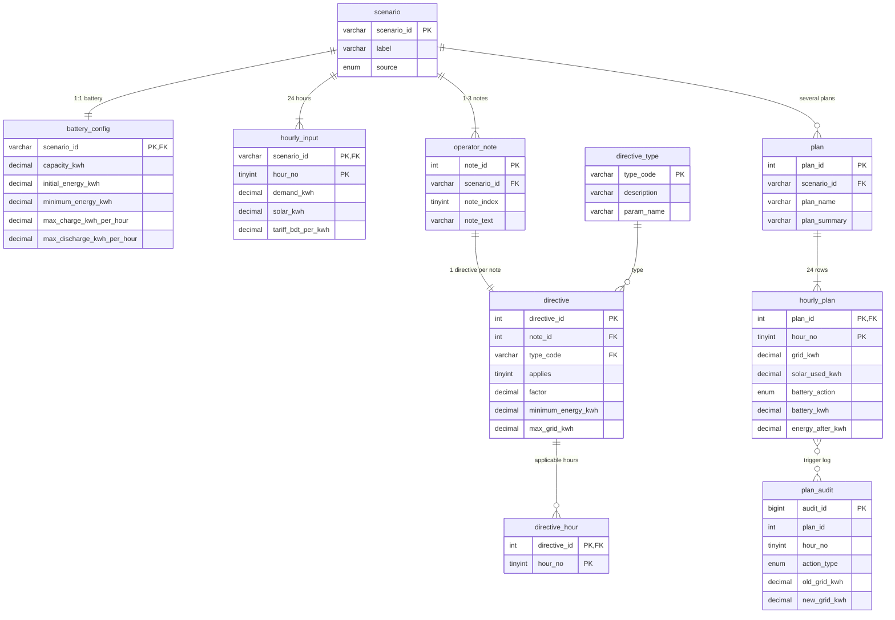

# ER Diagram and Normalization

Picture: `docs/ER_diagram.png` (source: `docs/ER_diagram.mmd`, Mermaid)

## ER diagram

## Tables (10)

| Table | Purpose | Keys |
|---|---|---|
| `scenario` | one 24-hour case | PK `scenario_id` |
| `battery_config` | battery limits of a case (1:1) | PK/FK `scenario_id` |
| `hourly_input` | hourly demand, solar, tariff (24 rows) | PK `(scenario_id, hour_no)` |
| `operator_note` | 1-3 operator notes | PK `note_id`, UNIQUE `(scenario_id, note_index)` |
| `directive_type` | the 6 directive kinds (lookup) | PK `type_code` |
| `directive` | interpretation of one note (1:1) | PK `directive_id`, UNIQUE `note_id` |
| `directive_hour` | hours a directive applies to | PK `(directive_id, hour_no)` |
| `plan` | several plans per case | PK `plan_id`, UNIQUE `(scenario_id, plan_name)` |
| `hourly_plan` | the 24 rows of a plan | PK `(plan_id, hour_no)` |
| `plan_audit` | trigger log | PK `audit_id` |

## How the JSON was split into tables

| JSON part | Table |
|---|---|
| `scenario_id`, `label` | `scenario` |
| `battery{}` | `battery_config` |
| `hours[24]` | `hourly_input` |
| `operator_notes[]` | `operator_note` |
| `directive_interpretation[]` | `directive` |
| `structured_adjustment.hours[]` | `directive_hour` |
| `hourly_plan[24]` | `hourly_plan` (under a row of `plan`) |
| `total_*`, `peak_grid_kwh` | not stored; computed by view `v_plan_totals` |

## Normalization

**1NF:** every cell holds one value. The `operator_notes` array and the `hours` array could have been stored as comma-separated text in one column, but that would break 1NF. So they became `operator_note` and `directive_hour`.

**2NF:** in tables with a composite key (`hourly_input`, `hourly_plan`, `directive_hour`) every non-key column depends on the whole key. Battery values depend on `scenario_id` only, so they live in `battery_config` instead of being repeated 24 times in `hourly_input` (that would be a partial dependency).

**3NF:** `description` and `param_name` of a directive type depend on `type_code`, so they sit in the lookup table `directive_type`. Total cost, total grid and peak grid can be computed from `hourly_plan`, so they are not stored anywhere (derived data is redundancy).

**BCNF:** every determinant is a candidate key.

## Deliberate trade-offs (good to mention to the teacher)

1. `directive` has three nullable columns (`factor`, `minimum_energy_kwh`, `max_grid_kwh`). The alternative was three separate tables, which is purer but needs many more JOINs. Instead one table is kept and CHECK constraints guarantee that exactly the parameter of the directive type is filled and the others are NULL.
2. `plan_audit` has no foreign key on purpose, so the history survives even when a plan is deleted.
3. Rules are enforced in three layers: CHECK constraints (single row values), triggers (rules that need other tables), and the view `v_plan_violations` (re-validation of a whole plan).
4. When several directives overlap in one hour, the strictest wins (smallest solar factor, largest reserve, smallest grid cap). The problem statement does not define this (it only says valid cases have no contradictory hard directives), so it is our assumption. Strictest is the safe choice: a plan that obeys the stricter rule also obeys the looser one.
5. The hours of a directive live in their own table (`directive_hour`, 1NF) and are inserted after the directive row. A trigger on `directive` therefore cannot require "at least one hour". The rule is covered in two ways: the procedure `sp_add_directive` (checks the hours and inserts directive + hours in one transaction) and the audit view `v_directive_issues`.
6. "Hours in ascending order" (a rule of the JSON format) is not stored: a table is an unordered set of rows, so the order is produced by `ORDER BY` when reading. Uniqueness is enforced by the primary key `(directive_id, hour_no)`.
7. `v_plan_status` is built from table `plan` with a LEFT JOIN, so a plan with no hourly rows is not hidden; it is listed as `INVALID`.

## Logic inside the database

| Kind | Name | What it does |
|---|---|---|
| Trigger | `trg_hplan_bi`, `trg_hplan_bu` | block bad `hourly_plan` rows: energy balance, solar limit, rate limits, battery bounds, continuity with the previous and next hour, end-of-day neutrality, all directive types |
| Trigger | `trg_hplan_au`, `trg_hplan_ad` | write every update/delete to `plan_audit` |
| Trigger | `trg_directive_bi`, `trg_directive_bu` | a reserve may not exceed the battery capacity |
| Procedure | `sp_check_plan_row`, `sp_check_directive` | the checks used inside the triggers (same logic for INSERT and UPDATE) |
| Procedure | `sp_add_directive` | adds a directive and its hours in one transaction; rejects no hours, hours outside 0-23, `no_op` with hours |
| Procedure | `sp_validate_plan` | full audit of one plan, returns a `VALID` row when nothing is wrong |
| Procedure | `sp_plan_report` | hour-by-hour report with running cost |
| Procedure | `sp_create_baseline_plan` | builds an "idle battery" comparison plan inside a transaction, rolls back if a directive forbids it |
| Procedure | `sp_selftest` | 18 automatic tests (rolls back at the end) |
| Function | `fn_plan_cost` | total cost of a plan |
| Views (11) | `v_hour_constraints`, `v_plan_rows`, `v_plan_totals`, `v_plan_violations`, `v_plan_status`, `v_plan_comparison`, `v_no_battery_cost`, `v_directive_hours`, `v_directive_summary`, `v_directive_issues`, `v_scenario_overview` | rule application, reports and audit |